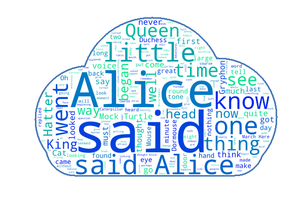
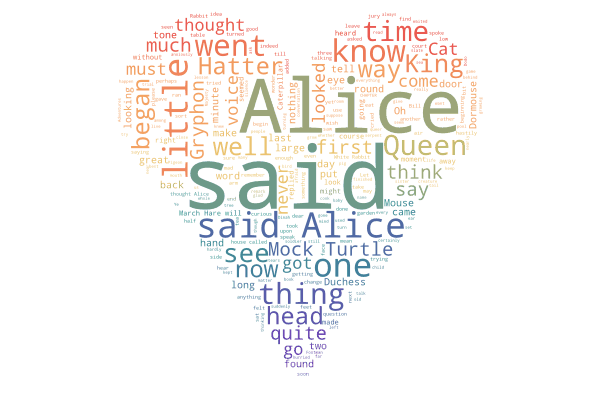
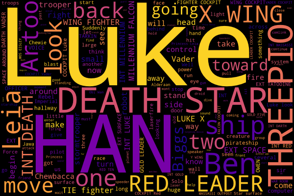
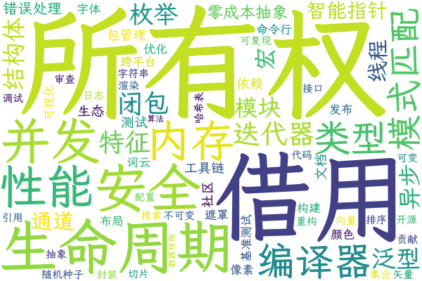
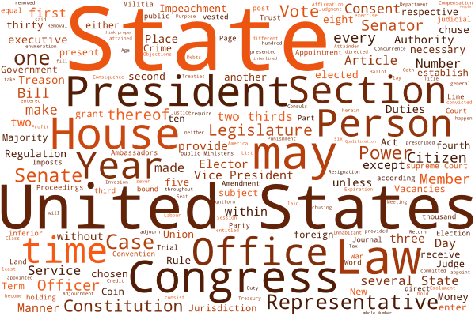
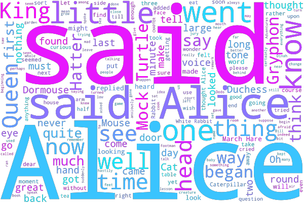

# wordcloud (Rust)

[](https://crates.io/crates/wordcloud)
[](https://docs.rs/wordcloud)

**English** | [简体中文](README.zh-CN.md)

A fast word cloud generator for Rust, as a library and a command-line tool. It is
a port of the Python [amueller/word_cloud](https://github.com/amueller/word_cloud)
package (v1.9.6), with the same options and defaults.

<table>
  <tr>
    <td width="33%" align="center" valign="top">
      <br>
      <b>Any shape</b><br>
      <sub>Use a mask image, with an optional outline<br><code>--mask shape.png --contour_width 3</code><br><a href="examples/shape_mask.rs">examples/shape_mask.rs</a></sub>
    </td>
    <td width="33%" align="center" valign="top">
      <br>
      <b>Colours from an image</b><br>
      <sub>Each word takes the colour of the picture behind it<br><code>--colormask picture.png</code><br><a href="examples/image_colors.rs">examples/image_colors.rs</a></sub>
    </td>
    <td width="33%" align="center" valign="top">
      <br>
      <b>Colormaps</b><br>
      <sub>18 built in, from viridis to jet<br><code>--colormap plasma</code><br><a href="examples/colormap.rs">examples/colormap.rs</a></sub>
    </td>
  </tr>
  <tr>
    <td width="33%" align="center" valign="top">
      <br>
      <b>Chinese and any font</b><br>
      <sub>Load any TTF, OTF or TTC font<br><code>--fontfile LXGWWenKai.ttf</code><br><a href="examples/custom_font.rs">examples/custom_font.rs</a></sub>
    </td>
    <td width="33%" align="center" valign="top">
      <br>
      <b>One colour, horizontal only</b><br>
      <sub>Shades of a single colour; control word orientation<br><code>--color "#b7410e" --prefer_horizontal 1</code><br><a href="examples/single_color.rs">examples/single_color.rs</a></sub>
    </td>
    <td width="33%" align="center" valign="top">
      <br>
      <b>Transparent background</b><br>
      <sub>RGBA PNG, ready to put on any page<br><code>--mode RGBA --background None</code><br><a href="examples/transparent.rs">examples/transparent.rs</a></sub>
    </td>
  </tr>
</table>

<sub>Every image above is generated by the code in <a href="examples/"><code>examples/</code></a>
(see <a href="#examples">Examples</a>). The Chinese tile shows the keywords of
<i>Journey to the West</i>, chapters 1–5, in the LXGW WenKai font.</sub>

> **Package name:** this repository is `wordcloud-rs`, but the crate is published
> on crates.io as **[`wordcloud`](https://crates.io/crates/wordcloud)**, the same
> name as `pip install wordcloud`. The crates.io crate called `wordcloud-rs` is an
> unrelated project. Install with `cargo add wordcloud` and import with
> `use wordcloud::...`.

## Features

* **Input**: raw text (tokenising, stopwords, plural folding and two-word phrases
  such as "White Rabbit" are handled for you) or your own `(word, weight)` list.
* **Shape and look**: masks with outlines, colormaps, a single colour, colours
  from an image or your own colour function, any font, margins, word orientation
  and size scaling.
* **Output**: PNG (RGB or transparent RGBA), SVG, or the raw layout (word, size,
  position, colour) to draw yourself.
* **Seed-exact**: CPython's Mersenne Twister, Python dict ordering, Pillow's
  `BLEND` and every legacy layout quirk are reproduced, so with the same glyph
  masks the layout and the PNG pixels match the Python package byte for byte.
* **Fast and light**: 7–19× faster end to end than the Python/Cython original, with a
  fraction of the memory (see [Benchmark](#benchmark)).
* **Safe**: `#![deny(unsafe_code)]`. The one exception is a single audited block
  (bounds-check elision in the occupancy window counter, guarded by an `assert!`),
  kept only because benchmarks show it is 12–15% faster than the safe forms.

## Benchmark

Same inputs and options for both tools; every number is the median over several
random seeds, each run as its own process.

| Workload | Python | Rust | Speed-up | Peak memory, Python → Rust |
|---|---:|---:|---:|---:|
| Default, 400×200 | 628 ms | **33 ms** | **19×** | 66 MB → **8 MB** |
| Large, 1000×700, 400 words | 2.61 s | **0.22 s** | **12×** | 83 MB → **11 MB** |
| Mask, 900×900, 400 words | 2.89 s | **0.27 s** | **11×** | 86 MB → **18 MB** |

**Stress tests**

| Workload | Python | Rust | Speed-up | Peak memory, Python → Rust |
|---|---:|---:|---:|---:|
| 50 MB of text | 9.0 s | **1.0 s** | **9×** | 756 MB → **86 MB** |
| 4K canvas, 3840×2160, 1000 words | 87.9 s | **12.4 s** | **7×** | 305 MB → **59 MB** |
| Very dense: 1000×700, 3000 words, min font 2, margin 1, `--repeat` | 35.2 s | **2.7 s** | **13×** | 86 MB → **12 MB** |

Timings are end to end on the command line (`python -m wordcloud` vs
`wordcloud`), so Python's 0.4–0.6 s of interpreter start-up and imports is included. Timing only
`WordCloud(...).generate(text).to_image()` inside a running interpreter, Python
takes 214 ms, 2.06 s and 2.25 s for the first three rows, so Rust is still
**6–9× faster** as a library.

<details>
<summary>Test machine and method</summary>

- CPU: Intel Xeon @ 2.80 GHz (Cascade Lake: family 6, model 85, stepping 7), 4 cores, KVM virtual machine
- Memory: 15.7 GiB
- OS: Ubuntu 24.04.5 LTS, Linux 6.18
- Rust: rustc 1.97.0, `cargo build --release` (fat LTO, no PGO)
- Python: 3.13.18, wordcloud 1.9.6, NumPy 2.5.4, Pillow 13.0.0
- Both tools are single-threaded, so the core count does not matter.
- Input: `tests/golden/alice.txt` (the upstream example). The 50 MB input is
  `alice.txt`, `a_new_hope.txt` and `constitution.txt` repeated.
- 10 seeds per workload, 3 for the stress tests. Time and peak RSS are taken
  per process with `wait4` (`tools/peak_rss.rs`).
- The two tools rasterise glyphs with different libraries (FreeType vs
  `ab_glyph`), so their layouts for a seed differ slightly and the work done is
  close but not identical.

Reproduce with:

```bash
cargo build --release
python3 -m venv /tmp/wc-venv && /tmp/wc-venv/bin/pip install wordcloud==1.9.6
python3 tools/benchmark.py --python /tmp/wc-venv/bin/python --runs 10 --stress-runs 3
```

</details>

## Install

```bash
cargo install wordcloud      # CLI, installs the `wordcloud` binary
cargo add wordcloud          # library
```

## CLI

Same flags and defaults as Python's `wordcloud_cli`. Run `wordcloud --help` for the full list.

```bash
# Text file in, PNG out, fixed seed for a reproducible layout
wordcloud --text alice.txt --imagefile alice.png --random_state 1

# Read from stdin, write to stdout
cat alice.txt | wordcloud > alice.png

# Larger canvas, white background, a colormap, and an SVG next to the PNG
wordcloud --text alice.txt --imagefile alice.png --svgfile alice.svg \
  --width 800 --height 400 --background white --colormap plasma

# Fill a shape: white pixels in the mask stay empty
wordcloud --text alice.txt --mask alice_mask.png --contour_width 3 \
  --contour_color steelblue --imagefile alice.png
```

Extras over Python: `--colormap` actually works (Python silently ignores it),
`--svgfile out.svg`, and `--fix-legacy-bugs`.

## Library

Minimal example: text in, PNG out.

```rust
use std::fs::{self, File};
use wordcloud::{render, WordCloud};

fn main() -> Result<(), Box<dyn std::error::Error>> {
    let text = fs::read_to_string("alice.txt")?;

    let wc = WordCloud::builder()
        .size(800, 400)
        .max_words(300)
        .seed(1) // same seed, same layout
        .build()?;

    let layout = wc.generate(&text)?;
    render::write_png(&render::to_image(&wc, &layout)?, File::create("alice.png")?)?;
    Ok(())
}
```

Your own frequencies, colours and SVG output:

```rust
use wordcloud::{color::ColorFunc, svg, Config, WordCloud};

fn main() -> Result<(), Box<dyn std::error::Error>> {
    let freqs = vec![
        ("Rust".to_string(), 10.0),
        ("safe".to_string(), 6.0),
        ("fast".to_string(), 5.0),
        ("cargo".to_string(), 3.0),
    ];

    let config = Config {
        width: 600,
        height: 300,
        background_color: Some("white".into()),
        ..Config::default()
    };
    let wc = WordCloud::builder()
        .config(config)
        .color_func(ColorFunc::colormap("plasma")?) // or ColorFunc::single("darkblue")?
        .seed(7)
        .build()?;

    let layout = wc.generate_from_frequencies(&freqs)?;
    for w in &layout.words {
        println!("{} size={} at {:?}", w.word, w.font_size, w.position);
    }
    std::fs::write("cloud.svg", svg::to_svg(&wc, &layout)?)?;
    Ok(())
}
```

Word shapes come from a `Mask`. White pixels are blocked, and the canvas takes
the mask's size. This example loads the mask with the
[`image`](https://crates.io/crates/image) crate (`cargo add image`):

```rust
use std::fs::{self, File};
use wordcloud::{render, Mask, WordCloud};

fn main() -> Result<(), Box<dyn std::error::Error>> {
    let img = image::open("alice_mask.png")?.to_rgb8();
    let mask = Mask::from_pixels(img.width() as usize, img.height() as usize, 3, img.as_raw())?;

    let wc = WordCloud::builder().mask(mask).seed(1).build()?;
    let layout = wc.generate(&fs::read_to_string("alice.txt")?)?;
    render::write_png(&render::to_image(&wc, &layout)?, File::create("alice.png")?)?;
    Ok(())
}
```

**Chinese, Japanese and other languages without spaces**: words are split on
non-letter characters, so a whole sentence counts as one word. Segment the text
first (for example with [`jieba-rs`](https://crates.io/crates/jieba-rs)) and
join the words with spaces, or pass `(word, weight)` pairs to
`generate_from_frequencies`. You also need a font that has the characters:
`--fontfile` on the CLI, or in code:

```rust
use std::fs::{self, File};
use wordcloud::{raster::AbGlyphRasterizer, render, WordCloud};

fn main() -> Result<(), Box<dyn std::error::Error>> {
    let font = AbGlyphRasterizer::from_bytes(fs::read("LXGWWenKai-Medium.ttf")?, true)?;
    let freqs: Vec<(String, f64)> = [("词云", 60.0), ("数据", 45.0), ("可视化", 40.0), ("开源", 32.0)]
        .into_iter()
        .map(|(w, n)| (w.to_string(), n))
        .collect();

    let wc = WordCloud::builder().rasterizer(Box::new(font)).seed(1).build()?;
    let layout = wc.generate_from_frequencies(&freqs)?;
    render::write_png(&render::to_image(&wc, &layout)?, File::create("zh.png")?)?;
    Ok(())
}
```

Stopwords, collocations, the tokeniser regex and the minimum word length can be
set through `Config::text`. See the [API docs](https://docs.rs/wordcloud) for every option.

## Examples

Each gallery image has a small, runnable example that draws it in English and in
Chinese. The Chinese fonts (SIL OFL) are downloaded by a script rather than
bundled:

```bash
sh examples/fetch_fonts.sh
cargo run --release --example shape_mask
```

| Example | Shows |
|---|---|
| [`shape_mask`](examples/shape_mask.rs) | Building a `Mask` and drawing an outline |
| [`image_colors`](examples/image_colors.rs) | Colouring words from a picture with `ImageColorGenerator` |
| [`colormap`](examples/colormap.rs) | Built-in colormaps |
| [`custom_font`](examples/custom_font.rs) | Loading a TTF/OTF font, Chinese text |
| [`single_color`](examples/single_color.rs) | One colour, horizontal-only layout, size scaling |
| [`transparent`](examples/transparent.rs) | RGBA output with no background |

The Chinese examples use public-domain classics from Project Gutenberg
(chapters in [`examples/data/zh/`](examples/data/zh/)), converted to simplified
characters with [`fast2s`](https://crates.io/crates/fast2s) and segmented with
[`jieba-rs`](https://crates.io/crates/jieba-rs) TF-IDF keyword extraction
(see [`examples/common/mod.rs`](examples/common/mod.rs)).

## Font rendering and parity

The default rasteriser is pure Rust (`ab_glyph`). FreeType + HarfBuzz hinting
differs slightly, so the *exact* layout for a seed differs from Python. To prove
the rest of the engine matches, `tools/record_pillow.py` records every glyph
Pillow produced and the hidden `--replay-glyphs` flag feeds them to the Rust
engine. `tools/parity.py` then compares layouts and pixels.

## Known differences

* Palette-mode (`P`) mask images are decoded to colours (Python compares the
  palette *indices* to 255).
* Grey-scale colour masks are accepted (Python raises `NotImplementedError`).
* `--contour_width` with `--mode RGBA` works (Python crashes on a broadcast error).
* Python's `\w` is approximated by `[\p{L}\p{N}_]`.
* SVG font embedding (`embed_font`) is not implemented.
* Contour rendering with `scale != 1` uses Catmull-Rom resizing, which approximates Pillow's bicubic filter.

## Repository layout

| Path | Contents |
|---|---|
| `src/` | Library and `wordcloud` binary |
| `tests/` | Golden-data parity, property, CLI and engine tests (`tests/golden/` holds data generated from the Python package) |
| `tools/` | `benchmark.py` + `peak_rss.rs` (README benchmark), `record_pillow.py` + `parity.py` (A/B harness), `make_golden.py`, `gen_tables.py`, `bench.py` |
| `docs/` | Migration blueprint, telemetry, the interactive report (`migration_infographic.html`) and the README gallery images (`gallery/`) |
| `examples/` | The examples that generate the gallery, with their input texts in `examples/data/` |

## License

MIT, like the upstream project. See `LICENSE` and `assets/README.md` for the bundled font.
