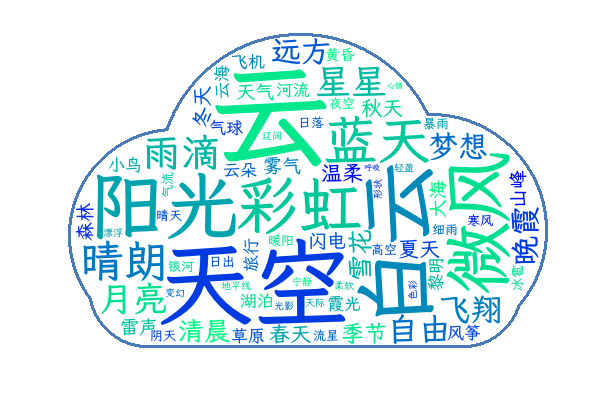
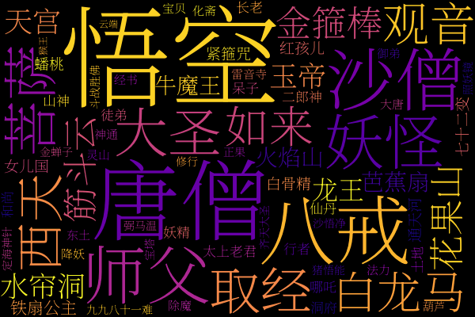
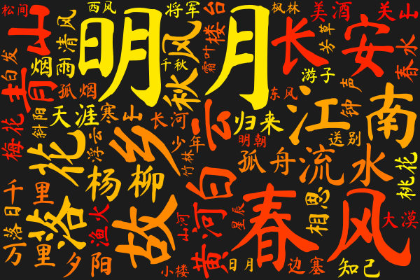
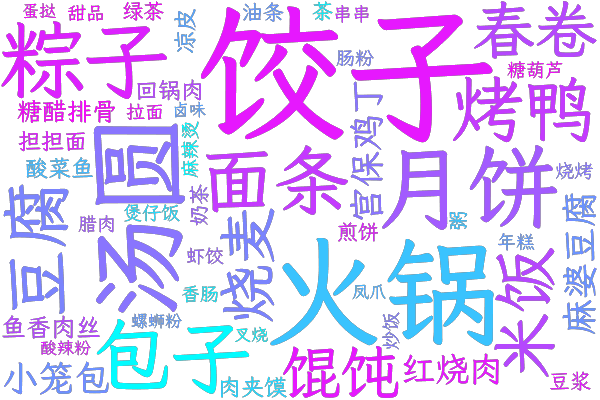

# wordcloud (Rust)

[](https://crates.io/crates/wordcloud)
[](https://docs.rs/wordcloud)

[English](README.md) | **简体中文**

一个快速的 Rust 词云生成器，既可以当库用，也可以当命令行工具用。它移植自 Python 的
[amueller/word_cloud](https://github.com/amueller/word_cloud)（v1.9.6），参数和默认值都与其一致。

<table>
  <tr>
    <td width="33%" align="center" valign="top">
      <br>
      <b>任意形状</b><br>
      <sub>用一张遮罩图片决定形状，可加轮廓线<br><code>--mask shape.png --contour_width 3</code></sub>
    </td>
    <td width="33%" align="center" valign="top">
      <br>
      <b>从图片取色</b><br>
      <sub>每个词使用它背后图片区域的颜色<br><code>--colormask picture.png</code></sub>
    </td>
    <td width="33%" align="center" valign="top">
      <br>
      <b>配色方案</b><br>
      <sub>内置 18 种，从 viridis 到 jet<br><code>--colormap plasma</code></sub>
    </td>
  </tr>
  <tr>
    <td width="33%" align="center" valign="top">
      <br>
      <b>任意字体</b><br>
      <sub>支持 TTF、OTF、TTC，书法字体也可以<br><code>--fontfile MaShanZheng-Regular.ttf</code></sub>
    </td>
    <td width="33%" align="center" valign="top">
      <br>
      <b>单色、只横排</b><br>
      <sub>同一颜色的不同深浅，可控制文字方向<br><code>--color "#b7410e" --prefer_horizontal 1</code></sub>
    </td>
    <td width="33%" align="center" valign="top">
      <br>
      <b>透明背景</b><br>
      <sub>输出 RGBA PNG，可直接放到任何页面上<br><code>--mode RGBA --background None</code></sub>
    </td>
  </tr>
</table>

<sub>以上图片都由本库生成，可以用
<a href="docs/gallery/make_gallery.py"><code>docs/gallery/make_gallery.py</code></a> 重新生成。
词表为手工整理的主题词；字体为霞鹜文楷、站酷快乐体、思源宋体和马善政楷书（均为 SIL OFL 开源字体，未随本库分发）。</sub>

> **关于包名：** 本仓库名为 `wordcloud-rs`，但在 crates.io 上发布的名字是
> **[`wordcloud`](https://crates.io/crates/wordcloud)**，与 `pip install wordcloud` 一致。
> crates.io 上名为 `wordcloud-rs` 的 crate 是另一个无关的项目。
> 安装用 `cargo add wordcloud`，导入用 `use wordcloud::...`。

## 功能

* **输入**：原始文本（分词、停用词、复数合并以及 "White Rabbit" 这类双词短语都会自动处理），
  或者你自己给出的 `(词, 权重)` 列表。
* **形状与外观**：带轮廓线的遮罩、配色方案、单一颜色、从图片取色或自定义着色函数、任意字体、
  边距、文字方向和字号缩放。
* **输出**：PNG（RGB 或透明 RGBA）、SVG，或者原始布局数据（词、字号、位置、颜色），方便你自己绘制。
* **与种子严格一致**：复现了 CPython 的梅森旋转随机数、Python 字典顺序、Pillow 的 `BLEND`
  以及所有历史布局怪癖，因此在字形位图相同的情况下，布局和 PNG 像素与 Python 版逐字节一致。
* **快**：端到端比 Python/Cython 原版快约 10 倍。
* **安全**：`#![deny(unsafe_code)]`。唯一的例外是一处经过审查的代码块（占用窗口计数中省略边界检查，
  并由 `assert!` 保护），保留它只是因为基准测试显示比安全写法快 12–15%。

## 安装

```bash
cargo install wordcloud      # 命令行工具，安装 `wordcloud` 可执行文件
cargo add wordcloud          # 作为库使用
```

## 命令行

参数和默认值与 Python 的 `wordcloud_cli` 相同。运行 `wordcloud --help` 查看全部参数。

```bash
# 读文本文件，输出 PNG，固定种子以得到可复现的布局
wordcloud --text alice.txt --imagefile alice.png --random_state 1

# 从标准输入读，写到标准输出
cat alice.txt | wordcloud > alice.png

# 更大的画布、白色背景、配色方案，并同时输出 SVG
wordcloud --text alice.txt --imagefile alice.png --svgfile alice.svg \
  --width 800 --height 400 --background white --colormap plasma

# 填充形状：遮罩中的白色像素保持空白
wordcloud --text alice.txt --mask alice_mask.png --contour_width 3 \
  --contour_color steelblue --imagefile alice.png

# 中文：先分好词并用空格隔开，再指定一个中文字体
wordcloud --text 已分词.txt --fontfile LXGWWenKai-Medium.ttf --no_collocations --imagefile zh.png
```

相比 Python 版新增：`--colormap` 真正生效（Python 版会静默忽略它）、`--svgfile out.svg`
以及 `--fix-legacy-bugs`。

## 库

最简示例：输入文本，输出 PNG。

```rust
use std::fs::{self, File};
use wordcloud::{render, WordCloud};

fn main() -> Result<(), Box<dyn std::error::Error>> {
    let text = fs::read_to_string("alice.txt")?;

    let wc = WordCloud::builder()
        .size(800, 400)
        .max_words(300)
        .seed(1) // 种子相同，布局就相同
        .build()?;

    let layout = wc.generate(&text)?;
    render::write_png(&render::to_image(&wc, &layout)?, File::create("alice.png")?)?;
    Ok(())
}
```

自己提供词频、设置颜色并输出 SVG：

```rust
use wordcloud::{color::ColorFunc, svg, Config, WordCloud};

fn main() -> Result<(), Box<dyn std::error::Error>> {
    let freqs = vec![
        ("Rust".to_string(), 10.0),
        ("safe".to_string(), 6.0),
        ("fast".to_string(), 5.0),
        ("cargo".to_string(), 3.0),
    ];

    let config = Config {
        width: 600,
        height: 300,
        background_color: Some("white".into()),
        ..Config::default()
    };
    let wc = WordCloud::builder()
        .config(config)
        .color_func(ColorFunc::colormap("plasma")?) // 或 ColorFunc::single("darkblue")?
        .seed(7)
        .build()?;

    let layout = wc.generate_from_frequencies(&freqs)?;
    for w in &layout.words {
        println!("{} size={} at {:?}", w.word, w.font_size, w.position);
    }
    std::fs::write("cloud.svg", svg::to_svg(&wc, &layout)?)?;
    Ok(())
}
```

形状由 `Mask` 决定：白色像素处不放文字，画布大小取遮罩的大小。下面的例子用
[`image`](https://crates.io/crates/image) crate 加载遮罩（`cargo add image`）：

```rust
use std::fs::{self, File};
use wordcloud::{render, Mask, WordCloud};

fn main() -> Result<(), Box<dyn std::error::Error>> {
    let img = image::open("alice_mask.png")?.to_rgb8();
    let mask = Mask::from_pixels(img.width() as usize, img.height() as usize, 3, img.as_raw())?;

    let wc = WordCloud::builder().mask(mask).seed(1).build()?;
    let layout = wc.generate(&fs::read_to_string("alice.txt")?)?;
    render::write_png(&render::to_image(&wc, &layout)?, File::create("alice.png")?)?;
    Ok(())
}
```

**中文、日文等不用空格分词的语言**：本库按非字母字符切分单词，所以一整句中文会被当成一个词。
请先分词（例如用 [`jieba-rs`](https://crates.io/crates/jieba-rs)）并用空格把词隔开，
或者直接把 `(词, 权重)` 传给 `generate_from_frequencies`。另外还需要一个包含这些字的字体，
命令行用 `--fontfile`，库里这样写：

```rust
use std::fs::{self, File};
use wordcloud::{raster::AbGlyphRasterizer, render, WordCloud};

fn main() -> Result<(), Box<dyn std::error::Error>> {
    let font = AbGlyphRasterizer::from_bytes(fs::read("LXGWWenKai-Medium.ttf")?, true)?;
    let freqs: Vec<(String, f64)> = [("词云", 60.0), ("数据", 45.0), ("可视化", 40.0), ("开源", 32.0)]
        .into_iter()
        .map(|(w, n)| (w.to_string(), n))
        .collect();

    let wc = WordCloud::builder().rasterizer(Box::new(font)).seed(1).build()?;
    let layout = wc.generate_from_frequencies(&freqs)?;
    render::write_png(&render::to_image(&wc, &layout)?, File::create("zh.png")?)?;
    Ok(())
}
```

停用词、双词短语、分词正则和最小词长都可以通过 `Config::text` 设置。全部选项见
[API 文档](https://docs.rs/wordcloud)。

## 字体渲染与一致性

默认的光栅化器是纯 Rust 的 `ab_glyph`。它与 FreeType + HarfBuzz 的字形微调略有差别，
所以同一个种子下的**精确**布局会与 Python 版不同。为了证明引擎其余部分完全一致，
`tools/record_pillow.py` 会记录 Pillow 生成的每个字形，再通过隐藏参数 `--replay-glyphs`
交给 Rust 引擎使用，最后由 `tools/parity.py` 比较布局和像素。

## 已知差异

* 调色板模式（`P`）的遮罩图片会先解码成颜色（Python 版是拿调色板*索引*和 255 比较）。
* 接受灰度的取色图片（Python 版会抛出 `NotImplementedError`）。
* `--contour_width` 与 `--mode RGBA` 可以一起用（Python 版会因广播错误崩溃）。
* Python 的 `\w` 用 `[\p{L}\p{N}_]` 近似。
* 未实现 SVG 字体嵌入（`embed_font`）。
* `scale != 1` 时的轮廓绘制使用 Catmull-Rom 缩放，近似 Pillow 的双三次滤波。

## 仓库结构

| 路径 | 内容 |
|---|---|
| `src/` | 库和 `wordcloud` 可执行文件 |
| `tests/` | 黄金数据一致性测试、属性测试、命令行测试和引擎测试（`tests/golden/` 存放由 Python 包生成的数据） |
| `tools/` | `record_pillow.py` + `parity.py`（A/B 对比工具）、`make_golden.py`、`gen_tables.py`、`bench.py` |
| `docs/` | 迁移方案、遥测数据、交互式报告（`migration_infographic.html`）以及 README 示例图（`gallery/`） |

## 许可证

MIT，与上游项目相同。内置字体的说明见 `LICENSE` 和 `assets/README.md`。
